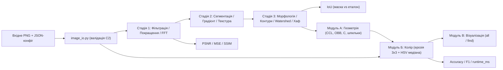

# Знахідник речей — Класичне розпізнавання деталей LEGO (`lego-classical-cv`)

[](https://github.com/Infoz1ty/Znahidnyk_Rechey_2021/actions/workflows/ci.yml)
[](LICENSE)

Командний **STEM-проєкт** із комп'ютерної графіки та цифрової обробки зображень: система автоматичного виявлення, класифікації (форма, тип поверхні, колір) та візуального пошуку деталей конструктора LEGO на фотографіях розсипів **виключно класичними алгоритмами**, реалізованими **вручну на Python + NumPy** (без машинного навчання, нейромереж та вбудованих CV-функцій OpenCV).

---

## Зміст

1. [Мета та практична цінність](#1-мета-та-практична-цінність)
2. [Суворі обмеження методички](#2-суворі-обмеження-методички)
3. [Архітектура та 4 пайплайни](#3-архітектура-та-4-пайплайни)
4. [Структура репозиторію та датасету](#4-структура-репозиторію-та-датасету)
5. [Встановлення та запуск з нуля](#5-встановлення-та-запуск-з-нуля)
6. [Режими роботи та вихідні артефакти](#6-режими-роботи-та-вихідні-артефакти)
7. [Тестування та статичний аналіз](#7-тестування-та-статичний-аналіз)
8. [Команда, Git-workflow та документація](#8-команда-git-workflow-та-документація)

---

## 1. Мета та практична цінність

* **Проблема:** пошук конкретної дрібної деталі LEGO (наприклад, синього брика `2x4` або гладкого тайла `2x2`) серед десятків інших у розсипі займає багато часу.
* **Рішення:** модульна CLI-програма, що приймає фото розсипу зверху ($90^\circ$), виділяє кожну деталь, класифікує її форму, тип поверхні (`brick` / `tile` / `round`) і колір, та дозволяє або **розмітити всі деталі** (`--mode all`), або **підсвітити лише потрібну деталь** (`--mode find --find "blue_2x4"`), затемнивши решту кадру на 70%.
* **Дослідницька мета:** кількісно (`PSNR`, `MSE`, `SSIM`, `IoU`, `Accuracy`, `F1-score`, час обробки) та якісно порівняти **4 різні класичні пайплайни** на гібридній вибірці з **110–120 зображень** (40 реальних фото в 3 сценаріях + 70–80 3D-рендерів Kaggle) і визначити умови ефективності та обмеження кожного підходу.

---

## 2. Суворі обмеження методички

1. **Жодного AI/ML:** нейронні мережі та моделі машинного навчання заборонені.
2. **100% ручна реалізація алгоритмів:** усі стадії пайплайнів, спільні класифікатори та метрики реалізуються вручну на `Python` + базових матричних операціях `NumPy`.
3. **Межа бібліотек:** `Pillow` використовується **виключно** для введення/виведення PNG та малювання фінальних рамок/підписів у візуалізаторі; `matplotlib` — лише для побудови графіків у звіті. Використання вбудованих CV-функцій (`cv2.*`, `scipy.ndimage.*`, `skimage.*`) заборонене.
4. **Відтворюваність:** усі параметри задаються через `configs/*.json` або аргументи CLI без зміни коду; випадкові компоненти (генератор тестового шуму для бенчмарку `PSNR/MSE/SSIM`) використовують фіксований `seed`.

---

## 3. Архітектура та 4 пайплайни

Система побудована за **двокроковою схемою** (детальніше — у [docs/architecture.md](docs/architecture.md)):
* **Крок 1 (Сегментація + Форма):** обраний пайплайн (`p1..p4`) фільтрує кадр, формує бінарну маску та зберігає проміжні результати кожної стадії; далі спільний `shape_classifier` визначає геометричний клас і тип поверхні (працює навіть на ч/б 3D-рендерах Kaggle).
* **Крок 2 (Колір):** спільний `color_classifier` звужує маску (ручна ерозія $3\times 3$), накладає її на вихідне RGB-зображення, переводить пікселі в `HSV` без відблисків/тіней і визначає колір за медіаною.



### Зведена таблиця пайплайнів (кожен містить 3 різні категорії)

| Учасник | ID | Назва пайплайну | Стадія 1 (Категорія) | Стадія 2 (Категорія) | Стадія 3 (Категорія) | Де перемагає | Очікуване обмеження |
| :--- | :---: | :--- | :--- | :--- | :--- | :--- | :--- |
| **Учасник 1** (`member1`) | `p1` | Колірно-морфологічний | Медіанний фільтр $5\times 5$ *(Фільтрація)* | Ручне `RGB→HSV` + поріг фону *(Колірна корекція)* | Морфологічне закриття + flood-fill *(Морфологія)* | Вільний розсип (Сценарій А): найвища швидкість і чисті межі | Світло-сірі/білі деталі на сірому фоні; злиплі одноколірні деталі |
| **Учасник 1** (`member1`) | `p2` | Контрастно-контурний | `RGB→LAB` + CLAHE + Гаус $3\times 3$ *(Гістограмна корекція)* | Бінаризація Оцу *(Сегментація)* | Детектор Кенні + злиття границь *(Контурний аналіз)* | Складне освітлення, низький контраст, 3D-рендери Kaggle | Різкі бокові тіні можуть додаватися до площі деталі |
| **Учасник 2** (`member2`) | `p3` | Градієнтний (Вододіл) | Білатеральний фільтр + Unsharp *(Ретушування/покращення)* | Оператор Собеля *(Контурний аналіз)* | Distance Transform + маркерний Watershed *(Сегментація)* | Щільний розсип (Сценарій В): розділення злиплих деталей | Можливе перерозділення дуже довгих пластин (`1x6`, `2x6`) |
| **Учасник 2** (`member2`) | `p4` | Частотно-текстурний | Ручне 2D FFT band-pass *(Перетворення Фур'є)* | LBP + GLCM текстурний аналіз *(Аналіз текстур)* | Кола Хафа для шпильок *(Перетворення Хафа)* | Мікс бриків і тайлів (Сценарій Б): точна детекція шпильок | Найбільший час виконання на один кадр |

---

## 4. Структура репозиторію та датасету

```text
Znahidnyk_Rechey_2021/
├── .github/workflows/ci.yml      # GitHub Actions: pylint (C4) + pytest (C3)
├── AGENTS.md                     # Правила розробки для команди та AI-агентів
├── pyproject.toml                # Залежності, налаштування pytest і pylint
├── requirements.txt              # Швидке встановлення залежностей
├── META-USAGE.md                 # Декларація використання генеративного ШІ
├── README.md                     # Головна документація та інструкція запуску
├── configs/
│   ├── default.json              # Спільні параметри (масштаб, HSV-палітра, seed=42)
│   ├── pipeline_p1.json          # Параметри П1 (Учасник 1)
│   ├── pipeline_p2.json          # Параметри П2 (Учасник 1)
│   ├── pipeline_p3.json          # Параметри П3 (Учасник 2)
│   └── pipeline_p4.json          # Параметри П4 (Учасник 2)
├── docs/
│   ├── architecture.md           # Повна архітектура, формули, контракти даних
│   ├── tz.md                     # Технічне завдання (критерії C1, D1, розподіл)
│   ├── tasks.md                  # Беклог і розподіл тасків для команди
│   └── report/                   # Матеріали фінального звіту (таблиці, графіки)
├── dataset/
│   ├── README.md                 # Пам'ятка зйомки та структури вибірки
│   ├── labels.csv                # Анотації еталонних класів і кількості деталей
│   ├── real_u1/                  # 20 реальних PNG-фото від Учасника 1
│   ├── real_u2/                  # 20 реальних PNG-фото від Учасника 2
│   ├── real_masks/               # 20 еталонних бінарних масок (10 У1 + 10 У2)
│   ├── kaggle_topdown/           # 70–80 відібраних PNG-рендерів зверху (90°)
│   ├── kaggle_masks/             # Автоматично згенеровані бінарні маски Kaggle
│   └── sample/                   # 2–3 демо-фото для швидкого запуску за README
├── scripts/
│   ├── convert_raw.py            # Конвертація .nef/.dng -> 8-бітні PNG (1600 px)
│   ├── generate_kaggle_masks.py  # Автогенерація еталонних масок для Kaggle
│   └── compare_pipelines.py      # Зведене порівняння П1–П4 та графіки для звіту
├── src/lego_cv/
│   ├── main.py                   # Точка входу CLI
│   ├── config.py                 # Завантаження, злиття і валідація JSON-конфігів
│   ├── core/                     # Спільна інфраструктура (I/O, runner, класифікатори, візуалізатор)
│   ├── metrics/                  # Ручні метрики (PSNR, MSE, SSIM, IoU, Accuracy/F1) + генератор шуму
│   └── pipelines/
│       ├── member1/              # Особиста зона Учасника 1 (p1_color_morph, p2_contrast_canny)
│       └── member2/              # Особиста зона Учасника 2 (p3_sobel_watershed, p4_fft_texture_hough)
└── tests/
    ├── test_core.py              # Контракти, крайні випадки (C2) та метрики
    ├── test_member1.py           # Автотести 3x3 / 5x5 для П1 і П2 (C3)
    └── test_member2.py           # Автотести 3x3 / 5x5 для П3 і П4 (C3)
```

---

## 5. Встановлення та запуск з нуля

> Перевірено для **Python 3.10+**. Ці команди використовуються під час демонстрації запуску на захисті (критерій **E1**).

### Крок 1. Клонування та створення віртуального середовища

**Windows (PowerShell):**
```powershell
git clone https://github.com/Infoz1ty/Znahidnyk_Rechey_2021.git
cd Znahidnyk_Rechey_2021
py -m venv .venv
.\.venv\Scripts\Activate.ps1
python -m pip install --upgrade pip
pip install -e ".[dev,analysis]"
```

**Linux / macOS (Bash):**
```bash
git clone https://github.com/Infoz1ty/Znahidnyk_Rechey_2021.git
cd Znahidnyk_Rechey_2021
python3 -m venv .venv
source .venv/bin/activate
python -m pip install --upgrade pip
pip install -e ".[dev,analysis]"
```

*(Альтернатива без editable-встановлення: `pip install -r requirements.txt` і запуск із `PYTHONPATH=src python -m lego_cv.main ...`).*

### Крок 2. Перевірка CLI та доступних пайплайнів

```bash
python -m lego_cv.main --list-pipelines
```

### Крок 3. Приклади запуску обробки

```bash
# 1. Запуск одного пайплайну (П1) у режимі повної розмітки зі збереженням проміжних стадій
python -m lego_cv.main \
  --pipeline p1 \
  --input dataset/sample \
  --output results/demo_p1 \
  --mode all \
  --save-stages

# 2. Режим пошуку конкретної деталі (затемнення решти кадру на 70%)
python -m lego_cv.main \
  --pipeline p3 \
  --input dataset/sample/demo.png \
  --output results/find_blue_2x4 \
  --mode find \
  --find "blue_2x4"

# 3. Пакетний прогін усіх 4 пайплайнів на вибірці з бенчмарком шуму (PSNR/MSE/SSIM) та IoU
python -m lego_cv.main \
  --pipeline all \
  --input dataset/real_u1 \
  --masks-dir dataset/real_masks \
  --labels-csv dataset/labels.csv \
  --output results/benchmark_real \
  --eval-denoise \
  --seed 42

# 4. Перевизначення параметра без зміни коду (через CLI або власний JSON-конфіг)
python -m lego_cv.main \
  --pipeline p2 \
  --config configs/pipeline_p2.json \
  --param stage3_canny.low_threshold=35 \
  --input dataset/sample \
  --output results/demo_p2_tuned
```

---

## 6. Режими роботи та вихідні артефакти

Після кожного запуску в директорії `--output` автоматично створюється структурований набір артефактів:

```text
results/<run_name>/
├── metrics.csv                   # Пофотографійні метрики: PSNR, MSE, SSIM, IoU, Accuracy, F1, runtime_ms
├── summary.json                  # Агрегована статистика (середнє/медіана/std по кожному пайплайну + параметри запуску)
└── <pipeline_id>/
    └── <image_stem>/
        ├── stage_1_*.png         # Проміжний результат Стадії 1
        ├── stage_2_*.png         # Проміжний результат Стадії 2
        ├── stage_3_*.png         # Проміжний результат Стадії 3 (фінальна маска)
        ├── annotated.png         # Фінальна візуалізація (--mode all або --mode find)
        └── detections.json       # Перелік знайдених деталей (клас, колір, площа, AR, C, шпильки, bbox)
```

---

## 7. Тестування та статичний аналіз

```bash
# Запуск усіх автотестів (критерій C3)
pytest -v

# Запуск лише тестів конкретної зони
pytest tests/test_core.py -v
pytest tests/test_member1.py -v
pytest tests/test_member2.py -v

# Статичний аналіз коду по всьому репозиторію (критерій C4, ціль: 10.00/10 — 0 зауважень)
pylint src tests scripts
```

---

## 8. Команда, Git-workflow та документація

### Розподіл відповідальності
* **Учасник 1 (`member1`):** `src/lego_cv/pipelines/member1/` (`p1`, `p2`), `configs/pipeline_p1.json`, `configs/pipeline_p2.json`, `tests/test_member1.py`, 20 реальних фото (`dataset/real_u1/`) + 10 масок, частина спільної інфраструктури.
* **Учасник 2 (`member2`):** `src/lego_cv/pipelines/member2/` (`p3`, `p4`), `configs/pipeline_p3.json`, `configs/pipeline_p4.json`, `tests/test_member2.py`, 20 реальних фото (`dataset/real_u2/`) + 10 масок + підготовка Kaggle, частина спільної інфраструктури.

### Правила Git (критерій A1)
1. Кожен учасник комітить у свою зону відповідальності **виключно під власним Git-акаунтом**.
2. Робота ведеться у тематичних гілках (`feat/member1-p1`, `feat/member2-p3`, `feat/core-metrics`) і зливається в `main` через Pull Request після проходження GitHub Actions CI (`pylint` + `pytest`).
3. Кожна публічна функція та клас повинні мати Google-style docstring, а нетривіальні алгоритмічні кроки — пояснювальні коментарі.

### Пов'язані документи
* [Правила розробки для команди та AI-агентів (AGENTS.md)](AGENTS.md)
* [Архітектура системи та математичний опис пайплайнів](docs/architecture.md)
* [Технічне завдання (ТЗ) та порогові метрики C1](docs/tz.md)
* [Декомпозиція тасків для команди](docs/tasks.md)
* [Пам'ятка зі зйомки та підготовки датасету](dataset/README.md)
* [Декларація використання генеративного ШІ (META-USAGE)](META-USAGE.md)
