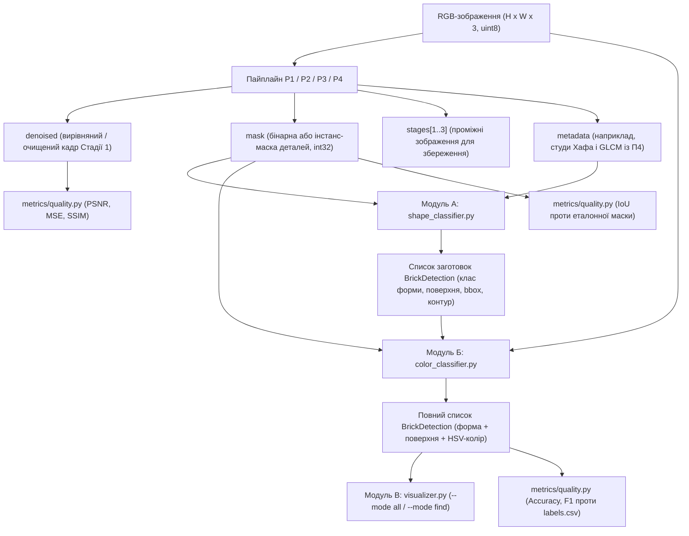

# Архітектура проєкту: «Знахідник речей» (LEGO Classical CV)

Цей документ фіксує технічну архітектуру програмної системи, межу допустимих бібліотек, математичний зміст кожної стадії пайплайнів **П1–П4**, спільних модулів класифікації та методики оцінювання метрик.

---

## 1. Концептуальна модель та інженерні обмеження

### 1.1. Умови формування вхідних даних
* **Розкладка:** одношаровий розсип деталей LEGO без перекриття по висоті на однотонній матовій поверхні (нейтрально-сірий або світло-бежевий папір/картон).
* **Ракурс і масштаб:** зйомка строго перпендикулярно зверху ($90^\circ$) із фіксованої висоти так, щоб після масштабування довгої сторони кадру до $1600\text{ px}$ одна базова шпилька `1x1 stud` займала $25\text{--}35\text{ px}$ (еталон у конфізі: `stud_size_px = 30`, отже $S_{1\times 1} \approx 900\text{ px}^2$).
* **Формат:** 8-бітні `PNG` без HDR та автоматичного покращення камерою.

### 1.2. Сувора межа використання бібліотек (вимога методички)

| Шар системи | Дозволені інструменти | Заборонено |
| :--- | :--- | :--- |
| **Алгоритми обробки (П1–П4)** | Стандартна бібліотека Python (`math`, `heapq`, `collections`) + базові матричні операції `numpy` (індексація, зрізи, поелементна арифметика) | `cv2.*` (фільтри, поріг, контури, морфологія, Хаф, watershed, `cvtColor`), `scipy.ndimage`, `skimage`, будь-які ML/DL-бібліотеки (`torch`, `sklearn`, `ultralytics`) |
| **Спільні класифікатори (Модулі А і Б)** | Ручний CCL (Union-Find/BFS), ручний контурний обхід, ручний PCA/OBB, ручна ерозія $3\times 3$, ручне `RGB→HSV` на `numpy` | `cv2.connectedComponents`, `cv2.findContours`, `cv2.minAreaRect`, `cv2.erode` |
| **Метрики якості** | Ручні формули `MSE`, `PSNR`, `SSIM`, `IoU`, `Accuracy`, `F1` на `numpy` | `skimage.metrics.*`, `sklearn.metrics.*` |
| **I/O та візуалізація** | `Pillow` (`PIL.Image`, `PIL.ImageDraw`, `PIL.ImageFont`) для читання/запису PNG і малювання рамок/підписів; `rawpy` лише в офлайн-скрипті `scripts/convert_raw.py` | Будь-які фільтри `PIL.ImageFilter` усередині пайплайнів |
| **Аналітика для звіту** | `matplotlib` у `scripts/compare_pipelines.py` | — |

---

## 2. Двокрокова схема розпізнавання

Розділення на **Крок 1 (геометрія + маска)** і **Крок 2 (колір)** дає дві переваги:
1. Усі 4 пайплайни однаково підключаються до спільних класифікаторів, що забезпечує чесне порівняння якості сегментації та фінального розпізнавання.
2. На 70–80 однотонних 3D-рендерах Kaggle можна об'єктивно перевірити Крок 1 (`IoU` + геометричний клас + шпильки), а на 40 реальних фотографіях — повний цикл **Крок 1 + Крок 2** (`IoU` + форма + колір).

---

## 3. Детальний опис 4 пайплайнів (ручні реалізації)

Кожен пайплайн наслідує `BasePipeline` (`src/lego_cv/core/base_pipeline.py`) і реалізує рівно 3 логічні стадії з **3 різних категорій методички**, повертаючи `StageOutput` після кожного кроку для автоматичного збереження на диск.

### 3.1. Пайплайн 1 (`p1`, Учасник 1): Колірно-морфологічний

* **Файл:** `src/lego_cv/pipelines/member1/p1_color_morph.py`
* **Конфіг:** `configs/pipeline_p1.json`
* **Комбінація категорій:** `1. Фільтрація` $\rightarrow$ `12. Колірна корекція/сегментація` $\rightarrow$ `5. Морфологічна обробка`

1. **Стадія 1 — Медіанний фільтр ($k \times k$, типово $5\times 5$):**
   * Симетричне відзеркалення меж (reflect padding) та обчислення медіани вікна $k \times k$ по кожному каналу `(R, G, B)` через ковзне вікно `numpy` (`sliding_window_view` або цикл із частковим сортуванням `np.partition`).
   * **Навіщо:** прибирає імпульсний шум матриці та дрібний пил без згладжування прямих кутів кубиків.
2. **Стадія 2 — Ручне `RGB → HSV` + колірна сегментація фону:**
   * Переведення `[0..255]` у `H ∈ [0, 360)`, `S ∈ [0, 255]`, `V ∈ [0, 255]` за аналітичними формулами.
   * Оцінка параметрів фону столу (або за фіксованим порогом $S < S_{\text{bg}}, V \in [V_{\min}, V_{\max}]$, або адаптивно по рамці кадру `border_margin_px` — медіана фону + відстань у HSV-просторі).
   * Інвертування маски фону для виділення об'єктів.
3. **Стадія 3 — Ручне морфологічне закриття + заповнення дірок:**
   * Структуруючий елемент $5\times 5$ (квадратний або дисковий): послідовно **дилатація** (максимум у вікні) $\rightarrow$ **ерозія** (мінімум у вікні), далі легке відкриття $3\times 3$ для прибирання поодинокого шуму.
   * **Заповнення внутрішніх отворів (hole filling):** ручний BFS/DFS `flood-fill` від зовнішніх пікселів рамки по фону; усі недосяжні фонові пікселі всередині деталей заповнюються як передній план (усуває «дірки» від відблисків на верхівках шпильок).

---

### 3.2. Пайплайн 2 (`p2`, Учасник 1): Контрастно-контурний

* **Файл:** `src/lego_cv/pipelines/member1/p2_contrast_canny.py`
* **Конфіг:** `configs/pipeline_p2.json`
* **Комбінація категорій:** `2. Гістограмна корекція` $\rightarrow$ `4. Сегментація зображень` $\rightarrow$ `3. Контурний аналіз`

1. **Стадія 1 — Ручне `RGB → CIE LAB` + CLAHE на каналі `L` + Гаус $3\times 3$:**
   * Переведення `sRGB → linear RGB → XYZ (D65) → CIE LAB` за стандартними матрицями, виділення каналу яскравості `L ∈ [0, 255]`.
   * **Ручний CLAHE:** розбиття `L` на сітку тайлів ($8\times 8$), побудова гістограм кожного тайлу, обрізання піків понад `clip_limit` із рівномірним перерозподілом надлишку по бінах, обчислення CDF та білінійна інтерполяція між 4 сусідніми тайлами для усунення швів.
   * Легка 2D-згортка з роздільним гаусовим ядром $3\times 3$ ($\sigma = 0.8$).
2. **Стадія 2 — Порогова бінаризація методом Оцу:**
   * Побудова нормованої гістограми $p(i)$ ($i = 0\dots 255$), перебір порогів $t$ із максимізацією міжкласової дисперсії:
     $$\sigma_B^2(t) = \omega_0(t)\omega_1(t)\bigl(\mu_0(t) - \mu_1(t)\bigr)^2$$
   * Формування бінарної маски переднього плану (з урахуванням світлого фону: `invert_foreground = true`).
3. **Стадія 3 — Ручний детектор границь Кенні + об'єднання з маскою:**
   * Обчислення градієнта $(G_x, G_y)$, модуля $M = \sqrt{G_x^2 + G_y^2}$ та напрямку $\theta = \operatorname{atan2}(G_y, G_x)$ (квантування на $0^\circ, 45^\circ, 90^\circ, 135^\circ$).
   * Придушення немаксимумів (**NMS**) уздовж напрямку градієнта.
   * Подвійний поріг (`low_threshold`, `high_threshold`) і трасування ребер гістерезисом (BFS від сильних пікселів по слабких).
   * Об'єднання замкнених контурів Кенні з пороговою маскою Оцу та замикання дрібних розривів для отримання суцільних контурів деталей.

---

### 3.3. Пайплайн 3 (`p3`, Учасник 2): Градієнтний із розділенням злиплих об'єктів

* **Файл:** `src/lego_cv/pipelines/member2/p3_sobel_watershed.py`
* **Конфіг:** `configs/pipeline_p3.json`
* **Комбінація категорій:** `11. Ретушування та покращення` $\rightarrow$ `3. Контурний аналіз` $\rightarrow$ `4. Сегментація зображень (Вододіл)`

1. **Стадія 1 — Ручний білатеральний фільтр + нерізке маскування (Unsharp Masking):**
   * Білатеральна згортка з просторовою вагою $w_s = \exp\!\left(-\frac{\Delta x^2 + \Delta y^2}{2\sigma_s^2}\right)$ та радіометричною вагою $w_r = \exp\!\left(-\frac{(I_p - I_q)^2}{2\sigma_r^2}\right)$ — прибирає фактуру паперу, зберігаючи різкий перепад на бортах кубиків.
   * Підвищення різкості: $I_{\text{sharp}} = \operatorname{clip}\bigl(I + \alpha \cdot (I - G_\sigma * I),\, 0,\, 255\bigr)$ для підсилення тонких щілин між злиплими деталями.
2. **Стадія 2 — Оператор Собеля та попередня маска переднього плану:**
   * Ручна 2D-згортка з ядрами $S_x, S_y$ для отримання градієнтного рельєфу $M = \sqrt{G_x^2 + G_y^2}$ (високі «хребти» на стиках сусідніх деталей).
   * Формування грубої маски переднього плану для обмеження області вододілу (відсікання фону столу).
3. **Стадія 3 — Ручна карта відстаней + маркерний алгоритм вододілу (Watershed):**
   * Обчислення карти відстаней до фону всередині маски переднього плану (двопрохідний алгоритм Chamfer 3-4 або точний роздільний Euclidean Distance Transform).
   * Пошук локальних максимумів карти відстаней із придушенням за мінімальною відстанню (`peak_min_distance_px`) $\rightarrow$ індивідуальні маркери $1, 2, \dots, K$ центрів деталей + маркер `0` для гарантованого фону.
   * **Маркерний Watershed із пріоритетною чергою (`heapq`):** затоплення пікселів у порядку зростання висоти градієнта $M(y, x)$ від маркерів; на зіткненні різних басейнів формуються розділювальні лінії, що фізично розрізають злиплі кубики. Повертається **інстанс-маска** (`int32`, де `0` — фон, `1..K` — ID окремих деталей).

---

### 3.4. Пайплайн 4 (`p4`, Учасник 2): Частотно-текстурний

* **Файл:** `src/lego_cv/pipelines/member2/p4_fft_texture_hough.py`
* **Конфіг:** `configs/pipeline_p4.json`
* **Комбінація категорій:** `7. Перетворення Фур'є` $\rightarrow$ `6. Аналіз текстур` $\rightarrow$ `13. Перетворення Хафа`

1. **Стадія 1 — Ручне 2D FFT та смугова частотна фільтрація:**
   * Доповнення кадру яскравості нулями (або reflect padding) до найближчого степеня двійки $(2^p \times 2^q)$.
   * Ручне 1D швидке перетворення Фур'є Кулі–Тьюкі (Radix-2 FFT) по рядках, потім по стовпцях (`2D FFT`), центрування низьких частот (`fftshift`).
   * Застосування гладкого смугового фільтра Баттерворта:
     $$H(u, v) = \frac{1}{1 + \left(\frac{D_L}{D(u,v) + \varepsilon}\right)^{2n}} \cdot \frac{1}{1 + \left(\frac{D(u,v)}{D_H}\right)^{2n}}$$
     (придушення $D < D_L$ вирівнює нерівномірне освітлення фону; придушення $D > D_H$ знімає високочастотний шум).
   * Обернене 2D IFFT та обрізання до вихідних розмірів.
2. **Стадія 2 — Локальні бінарні шаблони (LBP) + матриця суміжності (GLCM):**
   * Обчислення 8-сусіднього коду LBP для кожного пікселя та карти локальної текстурної дисперсії/ентропії у вікні $9\times 9$ для виділення об'єктів на однорідному фоні.
   * Для кожного виділеного кандидата обчислюється квантована матриця суміжності рівнів сірого **GLCM** ($16$ рівнів, кути $0^\circ, 45^\circ, 90^\circ, 135^\circ$) та її ознаки: **Контраст**, **Однорідність (Homogeneity)** та **Енергія**. Гладкі тайли мають високу однорідність і низький контраст порівняно з рельєфними бриками.
3. **Стадія 3 — Ручне перетворення Хафа для кіл (підрахунок шпильок):**
   * Усередині обмежувального прямокутника кожного кандидата обчислюється напрямок градієнта $\theta(y, x)$ на сильних краях ($|\nabla I| > T_g$).
   * Голосування в 3D-акумуляторі $(a, b, r)$ для діапазону радіусів шпильки $r \in [r_{\min}, r_{\max}]$ уздовж нормалі до ребра:
     $$a = x \pm r\cos\theta, \quad b = y \pm r\sin\theta$$
   * Пошук локальних піків акумулятора з мінімальною відстанню між центрами `min_center_distance_px` $\rightarrow$ кількість знайдених шпильок $K_{\text{studs}}$ зберігається в `metadata["stud_counts"]` та передається в Модуль А (для точного розрізнення `tile` vs `brick`).

---

## 4. Спільні модулі системи (`src/lego_cv/core/` та `metrics/`)

### 4.1. Модуль А: Геометричний класифікатор (`core/shape_classifier.py`)
* Якщо пайплайн повернув бінарну маску (`0/1`), виконується ручне маркування зв'язних компонентів (**2-pass Union-Find CCL**); якщо інстанс-маску (як `p3` Watershed) — використовуються готові ID компонентів.
* Відкидається дрібне сміття з площею $S < 0.5 \cdot S_{1\times 1}$.
* Для кожного компонента обчислюються:
  * **Нормована площа:** $N = S / S_{1\times 1}$;
  * **Периметр $P$:** підрахунок граничних пікселів / ручний обхід контуру (Moore-Neighbor tracing із вагою $1$ для ортогональних і $\sqrt{2}$ для діагональних переходів);
  * **Коефіцієнт округлості:** $C = \frac{4\pi S}{P^2}$ (для круглих `1x1_round` $C \ge 0.82$);
  * **Орієнтований обмежувальний прямокутник (OBB):** власні вектори коваріаційної матриці координат пікселів компонента (PCA-вирівнювання головних осей) $\rightarrow$ довжина $w$, ширина $h$, співвідношення сторін $AR = \max(w, h) / \min(w, h)$;
  * **Тип поверхні (`brick` / `tile` / `round`):** за $C$, кількістю шпильок $K_{\text{studs}}$ та текстурною однорідністю (якщо надано у `metadata`).

### 4.2. Модуль Б: Класифікатор кольору (`core/color_classifier.py`)
1. Ручна бінарна ерозія $3\times 3$ маски конкретної деталі (відсікає крайову тінь).
2. Ручне перетворення `RGB → HSV` внутрішніх пікселів деталі.
3. Відсіювання тіней заглиблень ($V < 40$) та світлових відблисків ($S < 25 \land V > 235$).
4. Обчислення **медіанного `(H, S, V)`** (із коректною циклічною медіаною для червоного сектору `H` біля $0^\circ/360^\circ$) та зіставлення з палітрою в `configs/default.json`.
5. Якщо на вхід подано чорно-білий кадр (`R == G == B`, як на 3D-рендерах Kaggle), класифікатор повертає мітку `"Grayscale"` (або `"Unknown"`), не перериваючи роботу Кроку 1.

### 4.3. Модуль В: Візуалізатор (`core/visualizer.py`)
* **`--mode all`:** малювання рамок/контурів та підписів (`Red 2x4 brick`, `Blue 2x2 tile`, `Yellow 1x1_round`) засобами `PIL.ImageDraw`.
* **`--mode find --find "blue_2x4"`:** парсинг запиту (`<color>_<shape>` або `<shape>`), затемнення всього зображення множником `dim_factor = 0.3` (мінус 70% яскравості), відновлення оригінальної яскравості всередині масок знайдених деталей і яскрава рамка підсвітки.

### 4.4. Модуль метрик та детермінованого шуму (`metrics/quality.py`, `metrics/noise.py`)
Щоб метрики з методички (`PSNR`, `MSE`, `SSIM`) були математично коректними на реальних фото без «ідеального чистого оригіналу», застосовується двоконтурна оцінка:
1. **Якість предобробки/шумоподавлення (`PSNR`, `MSE`, `SSIM`):**
   * У режимі `--eval-denoise` на вхідне зображення $I_{\text{ref}}$ накладається контрольований шум (гаусів або імпульсний) із **фіксованим `seed`** (`np.random.default_rng(seed)`), після чого Стадія 1 пайплайну очищає зашумлений кадр, і обчислюються `MSE`, `PSNR` та `SSIM` між $I_{\text{ref}}$ та $I_{\text{stage1}}$.
   * У звичайному режимі також фіксується `PSNR`/`MSE`/`SSIM` між оригіналом та виходом Стадії 1 (оцінка ступеня спотворення/втрати деталей при фільтрації).
2. **Якість сегментації (`IoU`):** $\text{IoU} = \frac{|M_{\text{pred}} \cap M_{\text{gt}}|}{|M_{\text{pred}} \cup M_{\text{gt}}|}$ на $90\text{--}100$ зображеннях із масками (`20` реальних + `70–80` Kaggle).
3. **Якість розпізнавання (`Accuracy`, `F1-score`) та швидкість (`runtime_ms`):** зіставлення з `dataset/labels.csv` і точний замір `time.perf_counter()` по кожній стадії.

### 4.5. Політика обробки крайніх випадків (критерій C2)
Усі вхідні файли та конфіги проходять валідацію в `core/image_io.py` та `config.py`:
* неіснуючий шлях, порожній файл (0 байт), битий заголовок PNG/JPG, непідтримуваний формат $\rightarrow$ контрольований виняток `ImageLoadError` (у batch-режимі файл логується у `summary.json["errors"]`, обробка решти вибірки не переривається);
* монохромні (1-канальні) зображення автоматично конвертуються у 3-канальний RGB, RGBA (4 канали) — накладаються на білий/нейтральний фон без альфа-каналу;
* зображення менші за `min_image_side_px` (напр., $1\times 1$) або з нульовою дисперсією (повністю чорний/білий кадр) обробляються без ділення на нуль (`MSE == 0 → PSNR = inf`, `SSIM` захищено константами $C_1, C_2$, `Otsu` повертає порожню маску без падіння).
