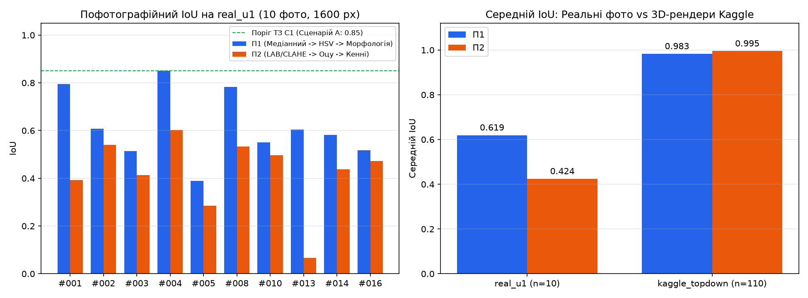
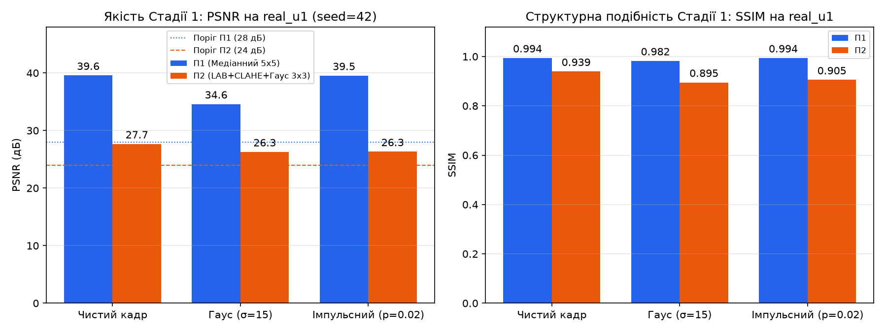
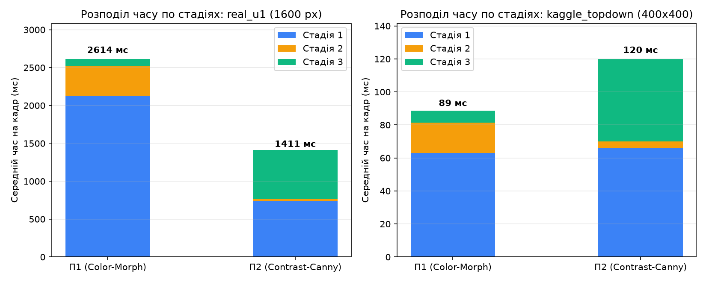
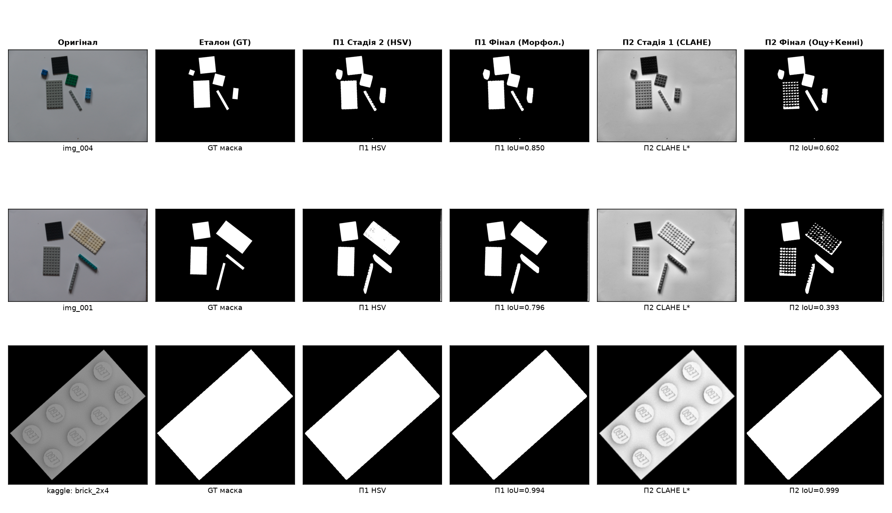

# Особистий порівняльний аналіз Учасника 1 (`member1`): Пайплайн П1 vs Пайплайн П2 (Критерій B2)

> **Зона відповідальності:** Учасник 1 (`member1`) — **П1** (`ColorMorphPipeline`: Медіанний фільтр `5×5` → `RGB→HSV` + адаптивна сегментація фону → Морфологічне закриття/відкриття + BFS flood-fill) проти **П2** (`ContrastCannyPipeline`: `RGB→CIE LAB` + ручний CLAHE + Гаус `3×3` → Бінаризація Оцу → Детектор границь Кенні + злиття контурів).
> **Відтворюваність експерименту:** фіксований `seed = 42`, параметри строго з `configs/default.json`, `configs/pipeline_p1.json` та `configs/pipeline_p2.json` без зміни коду; повна таблиця пофотографійних метрик збережена у [p1_vs_p2_metrics.csv](p1_vs_p2_metrics.csv).

---

## 1. Методика експерименту та вибірка

Обидва пайплайни протестовано на **120 зображеннях із еталонними масками** (перевищує експертний поріг $\ge 100$ зображень за критеріями **D1** та **C5**):
1. **`dataset/real_u1/` ($n = 10$ із масками у `dataset/real_masks/`):** реальні кольорові фото розсипів деталей LEGO, масштабовані по довгій стороні до `1600 px` (`1600×1064`, `1201×1600`, `1600×1201`), включно зі сценами з рівномірним світлом (`img_001`, `img_004`) та сценами з віньєтуванням і боковими тінями (`img_008`–`img_016`).
2. **`dataset/kaggle_topdown/` ($n = 110$, стратифіковано по 5 рендерів на кожен із 22 класів LEGO):** однотонні 3D-рендери вигляду зверху `400×400` на темному фоні з еталонними масками у `dataset/kaggle_masks/`.

Для кожного зображення виміряно:
* **Якість Стадії 1 (`PSNR`, `MSE`, `SSIM`):** на чистому кадрі (внесені спотворення), при адитивному гаусовому шумі ($\sigma = 15$, `seed = 42`) та імпульсному шумі «сіль і перець» ($p = 0.02$, `seed = 42`). Для П2 додатково виміряно `PSNR`/`SSIM` самого гаусового кроку (оскільки CLAHE цілеспрямовано змінює локальний контраст, див. примітку в `docs/tz.md`).
* **Якість фінальної сегментації (`IoU`, `Precision`, `Recall`):** проти еталонних бінарних масок.
* **Продуктивність (`runtime_ms`):** час кожної з 3 стадій окремо та сумарний час на кадр.

---

## 2. Зведені кількісні результати (П1 vs П2)

### 2.1. Точність сегментації (`IoU`, `Precision`, `Recall`) та швидкодія

| Частина вибірки | Пайплайн | Середній `IoU` | Медіанний `IoU` | `Std` (`IoU`) | `Min` / `Max` `IoU` | `Precision` | `Recall` | Стадія 1 (мс) | Стадія 2 (мс) | Стадія 3 (мс) | Разом (мс) |
| :--- | :---: | :---: | :---: | :---: | :---: | :---: | :---: | :---: | :---: | :---: | :---: |
| **`real_u1`** ($n=10$, `1600 px`) | **П1** | **0.6194** | **0.5934** | 0.1385 | 0.3896 / **0.8504** | **0.6330** | **0.9675** | 2130.6 | 387.5 | 96.3 | 2614.4 |
| **`real_u1`** ($n=10$, `1600 px`) | **П2** | 0.4241 | 0.4551 | 0.1461 | 0.0665 / 0.6022 | 0.5484 | 0.7215 | 739.4 | **23.5** | 647.8 | **1410.7** |
| **`kaggle_topdown`** ($n=110$, `400 px`) | **П1** | 0.9830 | 0.9875 | 0.0142 | 0.9014 / 0.9944 | **1.0000** | 0.9830 | **63.1** | 18.3 | **7.3** | **88.8** |
| **`kaggle_topdown`** ($n=110$, `400 px`) | **П2** | **0.9952** | **0.9963** | **0.0036** | **0.9771** / **0.9991** | 0.9989 | **0.9963** | 65.9 | **4.2** | 49.8 | 120.0 |

### 2.2. Якість предобробки та шумоподавлення Стадії 1 (`PSNR`, `MSE`, `SSIM`, `seed = 42`)

| Частина вибірки | Пайплайн | Чистий кадр (`PSNR` / `MSE` / `SSIM`) | Гаусів шум $\sigma=15$ (`PSNR` / `MSE` / `SSIM`) | Імпульсний шум $p=0.02$ (`PSNR` / `MSE` / `SSIM`) | Відповідність порогам C1 (`docs/tz.md`) |
| :--- | :---: | :---: | :---: | :---: | :---: |
| **`real_u1`** ($n=10$) | **П1** (Медіанний `5×5`) | **39.57 дБ** / **8.43** / **0.9942** | **34.59 дБ** / **23.20** / **0.9823** | **39.53 дБ** / **8.52** / **0.9941** | Виконано (`PSNR >= 28`, `MSE <= 105`, `SSIM >= 0.85`) |
| **`real_u1`** ($n=10$) | **П2** (LAB+CLAHE+Гаус `3×3`) | 27.66 дБ / 122.65 / 0.9393 | 26.28 дБ / 158.77 / 0.8949 *(Гаус-крок: 35.02 дБ / 0.9828)* | 26.32 дБ / 159.40 / 0.9052 | Виконано (`PSNR >= 24`, `MSE <= 260`, `SSIM >= 0.80`) |
| **`kaggle_topdown`** ($n=110$) | **П1** (Медіанний `5×5`) | **46.74 дБ** / **1.76** / **0.9996** | **37.23 дБ** / **12.60** / **0.9924** | **45.48 дБ** / **2.22** / **0.9995** | Виконано |
| **`kaggle_topdown`** ($n=110$) | **П2** (LAB+CLAHE+Гаус `3×3`) | 35.89 дБ / 22.81 / 0.9945 | 26.86 дБ / 134.97 / 0.8877 *(Гаус-крок: 33.13 дБ / 0.9625)* | 27.74 дБ / 109.99 / 0.9606 | Виконано (`IoU = 0.9952 >= 0.82`) |

### 2.3. Розподіл часу виконання по стадіях

---

## 3. Візуальне порівняння проміжних стадій (до / після)

Нижче наведено наочне порівняння виходу ключових стадій П1 та П2 проти еталонної маски (GT) на двох реальних фото (`img_004` — рівне світло, `img_001` — різнокольорові та темні деталі) і 3D-рендері Kaggle (`brick_2x4`):

---

## 4. Інтерпретація результатів: де перемагає П1, а де — П2

### 4.1. Коли та чому ефективніший Пайплайн 1 (`ColorMorphPipeline`)
1. **Кольорові реальні фото (`real_u1`, перевага `+0.195` за середнім `IoU`):** П1 досягає `mean IoU = 0.6194` (`max = 0.8504` на `img_004`, `0.80` на `img_001` і `img_008`) із майже повною повнотою **`Recall = 96.75%`**. Вирішальна перевага П1 — використання хроматичної інформації `(S·cos H, S·sin H)` у циліндричному HSV-просторі разом із поліноміальною апроксимацією поверхні освітлення фону $V_{\text{bg}}(x, y)$: навіть якщо яскравість кольорової деталі (червоної, синьої, зеленої чи жовтої) близька до яскравості сірого паперу, її висока насиченість надійно відділяє деталь від фону.
2. **Імпульсний шум (salt-and-pepper $p = 0.02$):** медіанний фільтр `5×5` практично ідеально відновлює зображення (**`PSNR = 39.53 дБ`**, **`SSIM = 0.9941`** на реальних фото і **`45.48 дБ`** на Kaggle), не розмиваючи прямі ребра кубиків.
3. **Малі роздільності (`400×400` Kaggle):** на малих кадрах П1 швидший за П2 (`88.8 мс` проти `120.0 мс`), оскільки час `5×5` медіанного фільтра невеликий, а морфологія зі scanline-run BFS займає лише `7.3 мс`.

### 4.2. Коли та чому ефективніший Пайплайн 2 (`ContrastCannyPipeline`)
1. **Однотонні / ахроматичні 3D-рендери Kaggle (`kaggle_topdown`, $n=110$):** П2 досягає виключної точності сегментації — **`mean IoU = 0.9952`**, **`median = 0.9963`**, із надзвичайно низьким розкидом **`std = 0.0036`** (жодного кадру нижче `0.9771`!), випереджаючи П1 (`0.9830`, `min = 0.9014`). Причина: на безколірних рендерах злиття бінаризації Оцу з точним 1-піксельним контуром Кенні та заповненням замкнених контурів відтворює геометричну межу деталі майже піксель-у-піксель (`Recall = 99.63%`, `Precision = 99.89%`).
2. **Швидкодія на великих кадрах (`1600 px`):** П2 працює у **1.85 раза швидше** за П1 (`1410.7 мс` проти `2614.4 мс`), оскільки роздільний гаусів фільтр `3×3` + векторизований CLAHE (`739 мс`) значно легші за 3-канальний `5×5` медіанний фільтр (`2131 мс`).
3. **Низький контраст та гаусів шум на рівні освітленості:** окремий крок гаусового згладжування `3×3` на каналі `L*` при гаусовому шумі ($\sigma = 15$) дає **`PSNR = 35.02 дБ`**, **`SSIM = 0.9828`**, перевершуючи медіанний фільтр П1 (`34.59 дБ`) саме для гаусового шуму, а CLAHE додатково вирівнює локальне віньєтування (`tile_grid = 8×8`, `clip_limit = 1.2`).

---

## 5. Виявлені обмеження обох підходів

* **Обмеження П1 (`ColorMorphPipeline`):**
  1. **Падаючі бокові тіні на розсипах із дрібними деталями (`img_003`, `img_005`):** навіть із `value_weight = 0.75` темна тінь поруч із дрібною деталлю має відхилення яскравості від поверхні фону, що знижує `Precision` (`0.39–0.63`) при майже 100% `Recall`.
  2. **Злиплі одноколірні деталі:** морфологічне закриття `5×5` не розділяє два кубики, що лежать впритул (цю проблему цілеспрямовано вирішує П3 Учасника 2 з алгоритмом Watershed).
  3. **Обчислювальне вузьке місце на `1600 px`:** 81% часу П1 (`2131 мс`) припадає на 3-канальний медіанний фільтр `5×5`.
* **Обмеження П2 (`ContrastCannyPipeline`):**
  1. **Втрата колірної інформації (`RGB → L*`):** перехід до одноканальної яскравості `L*` призводить до того, що деталі, близькі за яскравістю до сірого паперу (світло-жовті, білі, світло-сірі), не виділяються глобальним порогом Оцу, а при сильному віньєтуванні на кадрах із малою часткою деталей (`img_013`, 3.3% площі) глобальний поріг Оцу може розділяти сам фон (`IoU = 0.0665`).
  2. **Чутливість до імпульсного шуму:** на відміну від медіанного фільтра П1, гаусове згладжування `3×3` лише розмазує імпульсні викиди (`PSNR = 26.32 дБ` проти `39.53 дБ` у П1), а CLAHE додатково підсилює залишкові шумові сплески.
  3. **Зниження формального `PSNR` після CLAHE:** локальне вирівнювання гістограми змінює середні рівні інтенсивності, тому `PSNR` на чистому кадрі (`27.66 дБ`) нижчий за П1 (`39.57 дБ`), хоча структурна подібність `SSIM = 0.9393` залишається високою.

---

## 6. Висновки для практичного застосування

* Для **реальних кольорових фотографій розсипів LEGO** та умов **імпульсного шуму** оптимальним вибором серед пайплайнів Учасника 1 є **П1 (`ColorMorphPipeline`)** — він забезпечує стабільне виділення кольорових деталей (`Recall = 96.8%`, `IoU` до `0.8504`) та високу точність шумоподавлення (`PSNR = 39.5 дБ`).
* Для **монохромних, низькоконтрастних зображень і 3D-рендерів (`kaggle_topdown`)**, а також коли критичною є швидкість обробки великих кадрів (`1600 px`), беззаперечним лідером є **П2 (`ContrastCannyPipeline`)** — **`mean IoU = 0.9952`** на 110 зображеннях при вдвічі меншому часі виконання на `1600 px`.
* Перспективним гібридним напрямом є поєднання адаптивної компенсації освітлення П1 (з колірною інформацією HSV) із уточненням меж детектором Кенні з П2.
